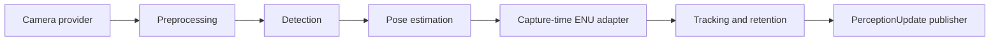

# Computer vision

[Shared integration contract](../INTEGRATION_README.md)

CV supports two paths: `ComputerVision` supplies prescribed bird observations
for the existing mission loop; `PerceptionPipeline` detects ArUco markers from
synthetic images or recorded video and optionally estimates camera-relative pose.
Neither path decides mission state or issues motion commands. No hardware,
PX4, ROS, or independent mission loop is required.

## Coordinator interface

```python
from cv.computer_vision import ComputerVision

records = []
cv = ComputerVision(
    timestamp_mapper=lambda source_ns: source_ns,  # Explicit shared origin.
    log_sink=records.append,  # Coordinator-owned callable receiving a dict.
)
cv.start_camera("cv/scenarios/integration_cycle.json", camera_id="front")
try:
    for tick in range(200):
        cv.set_log_context(state="IDLE")  # Use the actual mission State.value.
        observation = cv.read_due(tick * 100_000_000)
        if observation is not None:
            bird = observation.to_bird_snapshot()
            # Coordinator puts bird in snapshot['bird']; Safety checks age.
except StopIteration:
    pass  # Controlled scenario completion, not camera failure.
finally:
    cv.stop_camera()
```

`read_due(now_ns)` consumes all samples due at the supplied simulation time and
returns the latest one. A 15 Hz fixture in a 10 Hz loop can consume more than one
sample per tick. Every consumed sample is logged. Before the first sample is
due it returns `None`; the coordinator must treat that as unavailable input.
Between samples it returns the cached immutable observation without changing
its timestamp or logging it again. Safety owns freshness decisions (the shared
default maximum age is 0.5 seconds).

The mapper must be pure and strictly increasing; use a fixed simulation-origin
offset, never the current tick time. `now_ns` must be a nonnegative integer and
must not move backwards. A finite source ends at the scheduled time of the
sample immediately after its last frame. `StopIteration` remains stable on
subsequent scheduled reads, and `exhausted` is true. Stop/start explicitly
restarts the fixture and scheduling clock. A jump beyond the end consumes/logs
remaining due samples and raises `StopIteration` in that call.

`read()` remains available for sequential frame export. Do not mix it with
`read_due()` in the same camera session. Sequential reads retain their existing
source-clock output and optional mapped time.

## Shared bird snapshot

`observation.to_bird_snapshot()` returns a fresh schema-version-1 dictionary:

- `detected`: true for a fixture bird, false for valid absence, null for missing input.
- `valid`, `camera_ok`, `reason`: missing frames are invalid with `missing_frame`.
- `type`, `distance_m`: prescribed fixture values, not measured geometry.
- `timestamp_ns`, `clock`: mapped sample time and `simulation`.
- `source_timestamp_ns`, `source_clock`: unchanged fixture time and `fixture`.
- `source_id`, `camera_id`, `frame_index`, `synthetic`: sample identity/provenance.

The adapter requires an explicit clock mapper. Valid absence and missing input
remain distinct. The coordinator may copy camera status into its environment
section, preserving the sample's validity/time; CV never overwrites unrelated
battery, environmental, or docking fields. Association with any separately
supplied synthetic target can use source ID, camera ID and frame index.

## Fixtures and logging

- `scenarios/bird_demo.json`: original looping image demo.
- `scenarios/integration_cycle.json`: finite 15 Hz appearance, brief absence,
  reappearance, prolonged absence, and missing frames.
- `scenarios/stale_samples.json`: 1 Hz stream; at a 10 Hz loop, cached samples
  exceed the 0.5-second freshness limit before the next sample arrives.

These fixtures prescribe observations only. They do not assert return, Safety
permissions, alignment, or touchdown. Existing scenario validation rejects
malformed booleans, missing observation fields, and invalid fixture distances.

Inject `log_sink` to route CV events through the coordinator's shared logger.
Records contain `State` and `Details` (module, event, and source/sample metadata).
The coordinator owns the full JSONL tick stream. The default compatibility sink
uses `universal_log/Universal_log.py`; its text logs are not that tick stream.
`to_dict()` keeps the legacy CV observation shape; `to_bird_snapshot()` is the
shared-loop adapter. The standalone image exporter uses its own schema v2.

## Setup and checks

Generated exports in `cv/synthetic_output/` are ignored by Git. Commit scenario
definitions and generators; keep any deliberately curated regression images in
a separate fixtures directory.

In WSL, use the existing CV environment and run from the repository root:

```bash
source ~/venvs/contextualai-cv/bin/activate
cd /mnt/c/Users/capta/Documents/RCOS/ContextualAI/Phase0-MicroDrone
python -m unittest discover -s tests -p "test_computer_vision.py" -v
python -m unittest discover -s tests -p "test_cv_perception.py" -v
python -m cv.visual_demo
```

These run 17 fixture tests and 10 perception tests respectively. Verbose output
shows each test and its outcome; any failed assertion prints a traceback. Tests
are headless, including the test that writes and reads a temporary video. The
visual demo writes `cv/synthetic_output/visual_demo/comparison.png` with detected
corners and known versus estimated XYZ for centered, tilted, and empty scenes.
Open that image in VS Code. Its `results.json` contains full observations and
`observations.jsonl` contains pipeline logs. These are actual pixel-derived
results; the clean synthetic scene truth is used only for comparison.

From the repository root, in a Python environment:

```bash
python -m pip install -r cv/requirements.txt
python -m unittest discover -s tests -p test_computer_vision.py -v
python -m unittest discover -s tests -p test_cv_perception.py -v
python -m cv.synthetic_frames --scenario cv/scenarios/integration_cycle.json --headless --fast --once
```

The fixture path still produces prescribed booleans. Front and downward camera
IDs are supported. The perception path below produces measured camera-relative
marker pose, not world-frame docking alignment. Tested with Python 3.14,
OpenCV 4.14.0, and NumPy 2.5.4 in the repository's `.venv`.

## Pixel perception interface

```python
from cv.camera_providers import ImageSequenceProvider, render_marker
from cv.perception_pipeline import PerceptionPipeline
from cv.perception_types import CameraCalibration

calibration = CameraCalibration(
    "front_640", 640, 480,
    ((600., 0., 320.), (0., 600., 240.), (0., 0., 1.)),
)
provider = ImageSequenceProvider(
    [render_marker(calibration, marker_id=17)],
    camera_id="front", calibration_id=calibration.calibration_id,
)
records = []
with PerceptionPipeline(
    provider, calibration=calibration, marker_side_m=0.2,
    timestamp_mapper=lambda ns: ns, log_sink=records.append,
) as pipeline:
    pipeline.set_log_context(state="IDLE")  # Coordinator supplies State.value.
    observation = pipeline.read()
    print(observation.to_dict())
```

Replace the provider with `RecordedVideoProvider(path, camera_id="front",
calibration_id=calibration.calibration_id)` to use the same pipeline on recorded
pixels. Files must have known frame counts and constant FPS; timestamps use
`frame_index / fps` with `clock="media_fps"`. A decode failure before declared
EOF raises and logs an acquisition error; EOF raises `StopIteration` and closes
the source. `close()` is idempotent. Providers do not perform wall-clock pacing.

`read()` returns the existing `CVObservation` with additive fields: `detections`,
`processing_status`, `calibration_id`, and `timings_ns`. Its serialized perception
extension is named `cv_perception`, version 1. Legacy fixture serialization is
unchanged. Perception returns `bird=null`; `to_bird_snapshot()` rejects perception
results, so markers cannot accidentally become bird detections or launch inputs.
Use `valid`, `status`, and `detections` for generic perception, not the legacy
`detected` bird field. Missing/error results have `detections=null`; successful
empty images have an empty list. Detection without pose remains valid.

The default dictionary is `DICT_4X4_50`; IDs use `aruco:<numeric_dictionary>:<id>`.
All detected markers currently share the configured physical side length.
Confidence and tracking IDs remain null in the raw pipeline output. The optional
shared publisher below supplies track IDs. Pose uses iterative planar PnP with
positive-depth and reprojection checks (default maximum RMS error: 3 pixels).
This is a clean-scene baseline: planar pose ambiguity is not resolved using
temporal information, and a low reprojection error does not guarantee accurate
pose. Calibration ID and resolution must match. Corner order is top-left,
top-right, bottom-right, bottom-left in the decoded marker's orientation.

The clean renderer supports zero distortion; recorded-image pose estimation
accepts OpenCV distortion coefficients. Images and calibration use BGR uint8
pixels at the original resolution. Evaluation truth stays with the scene caller
and never enters the perception sample.

The coordinator still owns scheduling and clock mapping. This new pull API does
not implement `read_due()` and is not wired into `run_loop.py`. Logging state is
opaque context supplied by the caller; CV defines no mission-state enum and
cannot transition states. The existing eight state names remain unchanged.

Each processed sample emits a `State`/`Details` log record through the injected
sink. Durations cover acquisition, preprocessing, detection, pose, publication,
and total processing, excluding final logging overhead. The optional publisher
receives processing timings; its duration is known only afterward and appears in
the returned observation and log. Callback/logging exceptions propagate to the
caller. The offline benchmark below supplies run manifests and aggregate latency
reports. The shared publisher below adds persistent ArUco identity and lifecycle.

## Synthetic benchmark and replay

In the activated WSL `~/venvs/contextualai-cv` environment, from the repository root:

```bash
python -m unittest discover -s tests -p 'test_cv_benchmark.py' -v
# Quick run: 310 frames, ten per condition.
python -m cv.benchmark --output cv/synthetic_output/benchmark_quick --samples 10 --seed 2026
# Range assessment requires at least 100 samples per distance: 3,100 frames total.
python -m cv.benchmark --output cv/synthetic_output/benchmark_full --samples 100 --seed 2026
# Replay the exact saved PNGs; use a NEW output directory each time.
python -m cv.benchmark --dataset cv/synthetic_output/benchmark_full/dataset --output cv/synthetic_output/benchmark_replay
code cv/synthetic_output/benchmark_full/report.md
```

Existing output directories are refused to prevent overwriting evidence. Outputs:

| File | Contents |
| --- | --- |
| `dataset/manifest.json`, `dataset/images/*.png` | Seeds, per-frame settings, calibration, image hashes, and separate ground truth |
| `run.json`, `opencv_build.txt` | Effective detector/evaluator settings, warmup, software/build/machine information, Git revision and source hashes |
| `observations.jsonl` | Actual perception records; no evaluation truth |
| `evaluation.jsonl` | Per-frame TP/FP/FN, pose errors, and timings |
| `report.json`, `report.md` | Machine-readable metrics and a readable per-condition table |

There are 31 conditions: baseline, physical distance (0.5-6 m), in-plane rotation,
out-of-plane tilt, brightness, horizontal motion blur, partial occlusion, physical
marker size (scale), background clutter, two negative scenes, and a combined
stress case. Each present frame currently contains one marker with a seeded ID
and subpixel position variation. Multiple-marker detection has separate tests;
multi-object benchmark scenes remain an extension. Default seed 2026 is the
baseline; use a separately recorded seed for tuning and hold it fixed for comparisons.

Clutter stays behind the marker, including its white cells. Occlusion covers a
marker-coordinate strip and records actual raster area coverage. Every present
marker counts in the denominator, even under heavy occlusion. Brightness is a
pixel-intensity multiplier, not calibrated lux. Scale changes known physical
marker size at fixed distance; distance uses fixed size and calibration. Distortion
is zero; these scenes do not establish physical-camera performance.

Matching requires the same marker ID and ordered-corner RMS error at most 8 px
(`--tolerance-px`). Matching is one-to-one; duplicate/wrong-ID detections count as
FP and unmatched truth counts as FN. Undefined ratios are null. Reports include
detection rate and its 95% Wilson interval, precision, false positives per negative
frame, and pose coverage over both all truth and matched detections. Pose errors
cover X/Y/Z bias, MAE, RMSE, p95 absolute error; wrapped ZYX yaw/pitch/roll errors;
and rotation angular error. Euler metrics exclude near-singular poses and report
their count. Detection/pose failures remain visible rather than becoming zero error.

Range is the farthest contiguous passing tested distance, starting at the nearest,
with at least 100 objects per distance and a detection-rate point estimate >=95%.
Per-condition uncertainty intervals are reported separately. This applies only
to the clean synthetic distance sweep, not to combined degradations or docking
pose tolerances. A ten-sample quick run leaves qualified range null.

Three warmup frames per condition are excluded from metrics (`--warmup` changes
this); all evaluation frames are retained. Stage p50/p95/p99 latencies are in ms.
Acquisition includes file read, hash verification, and PNG decoding. Publication
is a no-op local callback; logging measures JSON serialization/buffered writes,
not durable fsync. `read_including_logging` includes the sink; `total_processing`
does not. Evaluation and image generation are outside pipeline timings. No
tracking-stage timing is claimed. Timing is machine/load-dependent and not
expected to reproduce exactly; accuracy replay is tested with the same software.

This benchmark changes no DetectionResult fields, tracking semantics, mission
states, Motion APIs, or coordinator behavior. It benchmarks raw perception;
tracking has its own validation suite and diagnostic replay below.

## Coordinator-facing PerceptionUpdate

**Purpose:** distinguish actual camera measurements from persistent track state.
**Publisher:** `cv.perception_publisher.PerceptionPublisher`, a CV-owned local
adapter. **Subscribers:** the coordinator and, through explicit routing, Docking,
Safety, and future Navigation/autonomy. Motion still receives approved commands.
**Rate:** one `update()` per consumed frame, plus optional coordinator-tick
heartbeats with no image. There is no background loop, ROS dependency, or command
dispatch. Existing `ComputerVision` bird fixtures and raw `PerceptionPipeline`
outputs are unchanged.

```python
from cv.perception_publisher import PerceptionPublisher
from cv.shared_perception import CameraToENU

# Construct once per camera/source session. pipeline is a PerceptionPipeline
# configured with the coordinator's explicit source-to-simulation timestamp_mapper.
shared_cv = PerceptionPublisher(
    publisher=lambda update: coordinator_queue.append(update.to_dict()),
    log_sink=shared_log_sink,
    confirmation_hits=2,
    max_gap_ns=500_000_000,
)

# Called only when the coordinator schedules a new camera sample:
shared_cv.set_log_context(state=current_state.value)
observation = pipeline.read()
update = shared_cv.update(
    observation,
    now_ns=clock.timestamp_ns,
    transform=camera_to_enu_at_capture,  # CameraToENU, or None if unavailable
)

# Between samples, advance lifecycle without replaying the last observation:
update = shared_cv.update(now_ns=clock.timestamp_ns)
```

The snippet defines the integration boundary; `coordinator_queue`, clock,
capture-time transforms, and scheduling are caller-owned and are not yet wired
into `run_loop.py`. Use either the callback or the return value as the consumption
path, not both. The callback gets the update before its own publication duration
is measurable; the returned/logged update additionally includes that duration.

### Envelope fields and their producers

`PerceptionUpdate.to_dict()` returns JSON-compatible data with these exact keys:

| Field | Meaning / producer |
| --- | --- |
| `schema_name`, `schema_version` | CV constants: `perception_update`, `1` |
| `session_id` | CV-generated unique session plus reset generation; a supplied base ID must be unique per run/stream |
| `source_id`, `source_camera` | Provider identity from `CVObservation.source_id` / `camera_id` |
| `clock` | `simulation`; all shared timestamps except explicitly named source time use this clock |
| `update_timestamp_ns` | Coordinator's integer `now_ns`; when this update is evaluated |
| `capture_timestamp_ns` | `CVObservation.simulation_timestamp_ns`, produced by the explicit clock mapper |
| `source_timestamp_ns`, `source_clock` | Original provider time/clock, unchanged |
| `frame_index` | Provider frame number |
| `synthetic` | Provider provenance; recorded-video pixels are not automatically synthetic |
| `sample_received` | True for a new observation; false for a heartbeat |
| `frame_valid` | Image availability from `camera_ok`; null on heartbeats |
| `valid` | New frame successfully processed; false for failure or heartbeat; not a pose/freshness permission |
| `reason` | Source/processing failure reason, `no_new_frame`, or null |
| `processing_status` | `ok`, `unavailable`, `error`, or `no_new_frame` |
| `detections` | Actual new detections only; always a list in the shared format |
| `tracks` | Full current camera/session track snapshot, plus one-update expiration records |
| `timings_ns` | Adapter/validation/transformation, tracking, and local publication durations; raw detector timings remain in the pipeline log |

On heartbeats, capture/source timestamps and frame index identify the last
received sample; they are not refreshed. `sample_received=false` makes this
explicit. A first sample is required before sending heartbeats. Missing frames
can be that first sample. EOF remains the provider's `StopIteration`, not a
fabricated missing image; the coordinator decides whether to stop or age tracks.

### Each `detections[]` entry

Internally this is `SharedDetectionResult`. Its `to_dict()` flattens its `WorldPose`:

| Fields | Meaning / producer |
| --- | --- |
| `timestamp_ns`, `clock` | Mapped image capture time, `simulation`; never publication time |
| `source_timestamp_ns`, `source_clock`, `source_id`, `source_camera` | Copied frame provenance so a detection can be inspected independently |
| `object_id`, `object_type` | Detector identity/type; internal `type` maps to shared `object_type` |
| `confidence`, `confidence_method` | Detector score/method; currently null, not a fabricated probability |
| `corners_px` | Four measured image corners in decoded marker order |
| `tracking_id`, `association_reason` | Tracker association; null ID for ambiguous, stale, or unsupported-type observations, with a reason |
| `valid`, `reason` | Actual image detection is valid; pose validity is independent |
| `position_x`, `position_y`, `position_z` | Marker-center ENU metres, or all null |
| `orientation` | Quaternion object `{x,y,z,w}` rotating marker-local vectors into ENU, or null |
| `yaw_deg` | Heading of marker +X projected onto ENU XY, zero east and CCW positive, in [0,360); null if that axis is vertical or pose unavailable |
| `pose_valid`, `pose_reason` | Whether world pose is available; e.g. `transform_unavailable`, `transform_time_mismatch`, `transform_camera_mismatch`, or source pose failure |
| `frame`, `origin_id`, `transform_id` | `local_enu` and the supplied transform's named origin/identity; identities null when pose unavailable |

`CameraToENU(source_camera, timestamp_ns, origin_id, translation_m, orientation,
transform_id)` must match the camera and exact mapped capture timestamp. It
implements `p_enu = R_camera_to_enu * p_camera + translation_m`. The coordinator
supplies the calibrated camera mounting transform composed with capture-time
vehicle attitude/position, or a known fixed camera-to-world transform. A latest
vehicle pose is not interchangeable with capture-time pose. Quaternion and
translation validation reject malformed/nonfinite input. No transform means
valid detection/identity but null shared pose, never relabeled camera geometry.

### Each `tracks[]` entry

| Fields | Meaning / producer |
| --- | --- |
| `tracking_id` | CV session/generation + monotonic track instance number |
| `object_id`, `object_type`, `source_id`, `source_camera` | Associated object's identity/provenance |
| `status` | `tentative`, `confirmed`, `temporarily_lost`, or `expired` |
| `estimate_kind` | `measured` or `retained`; `predicted` is reserved but never emitted yet |
| `last_observed_timestamp_ns` | Latest unambiguous matching detection's capture time |
| `estimate_timestamp_ns` | Time represented by the stored pose; unchanged during retention, null if pose unavailable |
| `hits` | Total associated, distinct observed samples; heartbeats/duplicates do not increment it |
| `confidence` | Last associated detection's confidence; does not become a track probability |
| `valid`, `reason` | Active identity versus expired identity; `valid=true` does not imply fresh measurement or usable pose |
| `velocity_m_s`, `position_covariance_m2` | Reserved nullable XYZ velocity and 3x3 position covariance; both null in the retention estimator |
| Pose fields | Same flattened ENU fields as above, held at `estimate_timestamp_ns` |

Track timestamps inherit the envelope's simulation clock. On a new associated
detection with unavailable pose, the track retains its identity but clears world
geometry; it does not present an older pose as a new measurement. On no matching
detection it retains the previous pose/time, marked `retained`. Predicted state
and a Kalman filter are not implemented. `LastMeasurementEstimator.observe()` /
`advance()` separate estimation from association/lifecycle for later replacement.

Default confirmation is two consecutive unambiguous observed frames. A genuinely
empty/missing/failed/ambiguous sample breaks the confirmation streak; a heartbeat
does not. Heartbeats retain the lifecycle status until expiry (no scheduled image
is not evidence of a missed detection), while marking the estimate `retained`.
A confirmed track stays confirmed on reacquisition within the gap.
Expiry occurs when `now_ns - last_observed_timestamp_ns >= 500_000_000` by default.
It emits `expired, valid=false` once, then disappears; reacquisition gets a new ID.
Thresholds are configurable CV identity policy, not Safety's freshness policy.

Only ArUco IDs are associated initially; other object types remain untracked.
Duplicate IDs in a view are ambiguous and update no track. Each publisher owns
one camera/source stream; there is no cross-camera fusion. Replayed or decreasing
frame indices, source times, or mapped times are rejected before track mutation.
Future captures and backwards update times are rejected. Call `reset()` after
source/clock restart or ENU-origin changes: it logs a reset, clears tracks, and
changes session generation. Consumers replace their cached track set on a new
session ID. State names are opaque log context only.

### Runnable coordinator payload examples

```bash
python -m unittest discover -s tests -p 'test_cv_tracking.py' -v
python -m cv.tracking_demo --output cv/synthetic_output/tracking_demo
code cv/synthetic_output/tracking_demo/measured.json
code cv/synthetic_output/tracking_demo/heartbeat.json
code cv/synthetic_output/tracking_demo/missing.json
code cv/synthetic_output/tracking_demo/expired.json
```

Use a new output directory on subsequent runs. `updates.jsonl` contains full
coordinator-ready payloads; `events.jsonl` includes raw perception and shared
publication records. The demonstration uses real pixel detections and an
explicitly synthetic downward-camera transform, not real drone extrinsics.

| Case | Envelope | Detection list | Track behavior |
| --- | --- | --- | --- |
| Marker observed | `valid=true`, `frame_valid=true` | Current detections | Measured, tentative/confirmed |
| Empty image | `valid=true`, `frame_valid=true` | Empty | Retained or expired |
| Missing image | `valid=false`, `frame_valid=false` | Empty | Retained or expired |
| Detector failed | `valid=false`, `frame_valid=true` | Empty | Retained or expired |
| Heartbeat | `valid=false`, `frame_valid=null`, `sample_received=false` | Empty | Retained or expired |

Malformed adapter inputs raise `ValueError` without changing tracks; the caller
must handle that failure rather than reuse a previous result as fresh. Callback
and logger errors propagate. Publication failures are logged when possible, but
do not roll back accepted measurements; this local callback is not a reliable
transport or retry queue. ROS2 message/IDL bindings and uXRCE-DDS remain pending.

### Required downstream changes (not implemented here)

- **Coordinator (`state_machine/run_loop.py`):** create one shared publisher per
  camera/source; supply `State.value`, clock mapping, capture-time transforms,
  and logger. Schedule raw `read()` only when a sample is due; call `update(None,
  now_ns=...)` between samples. Remove tick-time restamping for CV-sourced fields
  in the loop that currently assigns `timestamp_ns=now_ns` to snapshot sections.
  Keep snapshot tick time separate from measurement time. Queue and consume one
  update once; preserve source/frame identity and reset cached tracks on session
  change. Proposed placement is `snapshot['perception'] = update.to_dict()`;
  this new snapshot section still needs integration-team adoption.
- **Mission function (`state_machine/state_machine.py`):** preserve all eight
  state identities. Do not treat an ArUco marker as `bird.detected`. Existing
  bird fixture inputs remain separate until an explicit consumer adapter exists.
- **Motion / pose supplier:** provide a capture-time camera-to-ENU transform or
  the pose history needed to form it. Existing yaw-only vehicle pose suffices
  only for declared level-attitude synthetic fixtures; arbitrary camera attitude
  requires full orientation/extrinsics. No change to Motion command/ack APIs is
  required, and Motion should not consume detections directly.
- **Docking:** map the designated pad marker and its frame/origin to alignment
  inputs. Check pose validity and last-observed age; retained identity is not
  descent permission. Missing transform must yield unavailable alignment.
- **Safety:** explicitly assess measurement age, estimate kind, pose validity,
  and track status; do not infer freshness from update time or `track.valid`.
  Any future allowance for predicted geometry requires a separate policy.


## Phase 0 perception roadmap

The first implementation slice above is complete; the remaining work below is
planned. CV answers **what the camera sees**:
acquisition, detection, camera-relative pose, object tracking, and observations.
Action selection remains with Navigation, Docking, Safety, and the coordinator.
Preserve the existing fixture API while developing the image-based pipeline.



### Providers and detection contract

Use a common provider interface (`read() -> FrameSample`, `close()`) for synthetic
images and recorded video, with physical cameras supported later. Samples carry
pixels, frame number, source/camera identity, capture timestamp and clock,
validity/reason, and calibration identity. Keep missing input, processing failure,
valid empty frames, and finite-source EOF distinct. Preserve source timestamps;
the coordinator owns clock mapping and scheduling.

Prefer the existing `CVObservation` interface and serialized field names wherever
they convey the required information. Extend it additively for perception; do not
replace it or introduce aliases solely to match the suggested terminology.

| Suggested information | Current interface | Decision |
| --- | --- | --- |
| Timestamp | `timestamp_ns`, `clock`, optional mapped simulation time | Keep; already explicit about units and clock |
| Source camera | `camera_id` | Keep; no `source_camera` alias needed |
| Confidence | Nullable `confidence` in the observation and `to_dict()` | Keep; currently unset by the fixture reader and omitted from `to_bird_snapshot()` |
| Object type | `bird_type`, serialized as `bird.type`; snapshot uses `type` | Keep for bird observations; use `type` for future generic detection entries |
| Object ID | None; `source_id` identifies the input source | Add per-object identity; do not repurpose `source_id` |
| X/Y/Z position | Only fixture `distance_m` | Add camera-relative position; scalar distance cannot encode 3D location |
| Orientation | None | Add nullable orientation |
| Tracking ID | None; `frame_index` identifies a frame | Add persistent track identity |

The current interface therefore covers part of the suggested contract, not all
of it. Preserve its availability/status, provenance, scheduling, and legacy bird
snapshot semantics. The standalone image exporter already has a `detections`
list (`label`, `bbox_xywh`, `confidence`), but it contains prescribed metadata,
not measured pose or persistent identity, and is not the runtime observation API.

The implemented optional generic `detections` collection sits alongside the existing bird
fields, with processing status and stage timings at frame level. Keep timestamps
and `camera_id` in the shared frame envelope rather than duplicating them per
object. Existing fixture-only callers must continue to work; distinguish an
unpopulated generic result from a successfully processed empty list. Version any
serialized extension explicitly and test legacy adapters. Generic detections do
not populate the legacy bird fields automatically.

Proposed per-object additions reuse existing terminology where applicable:

| Field | Meaning |
| --- | --- |
| `object_id`, `type` | Initially dictionary/marker ID and `aruco_marker`; `type` follows the existing serialized convention |
| `confidence`, `confidence_method` | Nullable score and its meaning; do not invent a probability |
| `position_x`, `position_y`, `position_z` | Marker-center translation in camera-relative metres; null without valid pose |
| `orientation` | Quaternion `{x,y,z,w}` rotating marker-frame vectors into camera-frame vectors |
| `tracking_id` | Camera/session-local track instance, distinct from marker identity |
| `corners_px` | Ordered image corners |
| `pose_valid`, `pose_reason`, `reprojection_error_px` | Pose validity and quality, independent of detection success |

Use camera axes x right, y down, z forward; marker axes x right, y up, z out of
the printed face. Record the solver's corner order. Metric pose requires camera
intrinsics, distortion, resolution, and physical marker size. Resizing/cropping
must preserve calibration consistency. A detection without calibration retains
its corners and identity with null pose. Missing quantities are null, not zero.

Camera coordinates require an explicit calibrated transform before use in the
integration loop's ENU frame. An ArUco detection must never become a bird
observation. Replacing synthetic docking alignment requires a validated adapter.

### Synthetic datasets and evaluation

Generate seeded scenes with calibrated marker geometry and separate ground-truth
manifests. The detector and tracker receive pixels, never truth metadata. Include
clean scenes, marker-free negatives, clutter, partial occlusion, variable lighting,
motion blur, rotation, scaling, and multiple markers. Save calibration, marker
sizes, poses, seeds, and degradation parameters for replay. Keep evaluation seeds
separate from tuning scenes.

Benchmark distance, rotation, lighting, projected scale, and occlusion. Physical
range requires known marker size and calibration; pixel resizing alone cannot
establish metres. Match predictions to truth one-to-one with declared identity
and image-position tolerances, counting duplicates as false positives. Report:

- Detection rate `TP/(TP+FN)`, precision, FP/FN counts, and false positives per
  negative frame, with sample counts and uncertainty intervals.
- X/Y/Z bias, MAE, RMSE, and p95 error; yaw/pitch/roll errors with a declared Euler
  convention and wrapped angles, plus quaternion angular error.
- Pose-valid coverage and failures separately from errors on successful poses.
- Maximum reliable tested range under a declared condition envelope and agreed
  detection/pose thresholds. Synthetic results do not establish hardware range.

### Tracking and instrumentation

Associate marker identities within each camera/session. Preserve track IDs over
a configured short gap, expire them using source time, and reset on source restart.
Flag duplicate marker IDs as ambiguous. Retained tracks must not appear as fresh
observations. Cross-camera association and prediction can wait.

Log every processed frame, including empty/failed frames, with timestamps, frame
number, detections, confidence, pose, track IDs, and processing times. Record run
configuration, software versions, calibration, dataset seed/manifest, and dropped
frames. Retain input media or a reproducible manifest for later investigation.

Measure acquisition, preprocessing, detection, pose estimation, tracking, and
publication with a monotonic performance clock. Publication timing covers the
local callback/queue operation; measure logging overhead separately. Report total
and stage p50/p95/p99 latency with machine, resolution, and sample counts.

### Implementation order and completion

1. **Implemented:** frame/detection contracts and synthetic/recorded providers.
2. **Implemented:** pixel-based ArUco detection, clean-scene calibrated pose,
   per-frame logs/timing hooks, and fixture compatibility tests.
3. **Implemented:** seeded single-marker degradation sweeps, saved-image replay,
   detection/pose benchmarks, run manifests, and aggregate latency reports.
4. **Implemented:** camera-local marker tracking, retention/expiry, shared
   detections and track snapshots, and explicit capture-time ENU transformation.
5. **Remaining:** coordinator wiring and transform supply, multi-object benchmark
   scenes, predictive estimation/Kalman filtering, and ROS2 transport bindings.

Acceptance requires the same detector to process synthetic images and recorded
video, reproducible benchmark reports, and logs explaining failures without drone
hardware. Test pixel behavior, pose accuracy, lifecycle errors, tracking expiry,
and evaluation accounting. Changing truth metadata alone must not change output.

Defer bird species classification, ML models, threat classification, behavior
prediction, deterrence selection, and autonomous mission planning.
